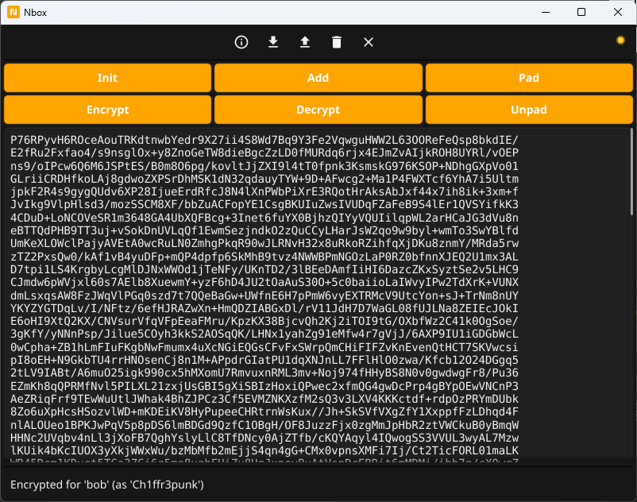

# NaClbox

A minimal, modern, cross-platform tool for encrypted 1:1 messaging based on
NaCl (Networking and Cryptography library) primitives by [DJB](https://en.wikipedia.org/wiki/Daniel_J._Bernstein).

NaClbox is designed for users who want strong, misuse-resistant cryptography without the complexity and legacy baggage of OpenPGP. It focuses on a clean workflow: create an identity, exchange public keys, encrypt a message, share the Base64 ciphertext through any channel, and decrypt it on the other side.

## Features

- **Modern cryptography**  
  - `NaCl box` (Curve25519 + XSalsa20 + Poly1305) for message encryption  
  - `NaCl secretbox` (XSalsa20-Poly1305) for the encrypted vault  
  - `Argon2id` (64 MiB, 3 iterations, 4 threads) for key Derivation  
- **Single encrypted vault** (`vault.enc`) — no plaintext keys on disk  
- **memguard** for passphrases and short-lived secrets in RAM  
- **Auto-lock** after 5 minutes of inactivity (configurable)  
- **Secure clipboard** — copied text is wiped after 15 seconds (configurable)  
- **Rate limiting** for decryption attempts (5 per minute)  
- **Identity import/export** as PEM files  
- **Optional ISO padding** to 4096-byte blocks (uniform ciphertext size)  
- **Base64 output** with exactly 76 characters per line  
- **Cross-platform** via the Fyne Storage API (Linux, macOS, Windows, Android, iOS)  
- **Portable mode on Windows** (vault next to the executable)  
- **NIST SP 800-63B compliant** passphrases (minimum 15 characters)  
- **Horizontal and vertical scrollbars** in the text area  

## Screenshot



## Usage

1. Create your identity
Click Init, enter a name (e.g. self), and confirm. NaClbox generates a Curve25519 key pair and stores it inside the encrypted vault. A modal window displays your public key in PEM format — share it with your peers.

You can copy the public key to the clipboard with one click. The clipboard is wiped automatically after 15 seconds.

2. Add a peer
Click Add, load the peer's public key PEM file, and give the peer a name. The public key is stored inside the vault.

3. Encrypt a message
Type your message into the text area and click Encrypt. Choose your identity and the recipient. NaClbox encrypts the message and replaces the content with Base64-wrapped ciphertext (76 characters per line).

Copy the ciphertext and send it to your peer through any channel.

Optional: click Pad before encrypting to pad the plaintext to the next 4096-byte boundary. This hides the message length.

4. Decrypt a message
Paste the ciphertext into the text area and click Decrypt. NaClbox tries every combination of your identities and known peers until it finds the matching key pair, then replaces the content with the plaintext.

If the plaintext was padded, click Unpad to strip the padding.

## Security design

Threat model
NaClbox assumes the following:

The attacker may have access to the encrypted vault file (vault.enc)  

The attacker may have access to the Base64 ciphertext exchanged between Peers  

The attacker does not have live access to the process memory while the vault is unlocked  

The attacker does not have root on the running machine  

On-disk format
The vault is a single file (vault.enc) containing:  

Base64( salt(16) || nonce(24) || secretbox-ciphertext )  
The plaintext inside the secretbox is a packed map of all keys:  

for each entry:  
  uint32_le(len(name)) || name  
  uint32_le(len(content)) || content  
Argon2id derives a 32-byte key from the user's passphrase and the random salt. NaCl secretbox encrypts the entire packed map with that key.

Memory handling
Passphrases are held in memguard.LockedBuffer and destroyed after use  

The Argon2id-derived key is wrapped in memguard during encryption/decryption  

Plaintext messages during encrypt/decrypt are held in memguard  

The in-memory vault map lives in the Go heap (not memguard) — this is a deliberate trade-off for practicality; the vault is always encrypted on disk

memguard.Purge() is called on shutdown

Auto-lock
After 5 minutes of inactivity (configurable via autoLockDuration), the vault is locked: the passphrase buffer is destroyed, the in-memory entries are overwritten and cleared, and the text area and clipboard are wiped. The next operation prompts for the passphrase again.

Secure clipboard
Text copied via the Copy to Clipboard button is wiped from the clipboard after 15 seconds — but only if the clipboard still holds the exact text we put there. This avoids clobbering user-copied data.

Rate limiting
Decryption attempts are limited to 5 per minute. This slows down brute-force attacks against the NaCl box authentication tag.

File locations
Platform	Vault path
Linux	~/.local/share/oc2mx.net.naclbox/vault.enc  
macOS	~/Library/Application Support/oc2mx.net.naclbox/vault.enc  
Windows (standard)	%APPDATA%\oc2mx.net.naclbox\vault.enc  
Windows (portable)	<exe-dir>\.Nbox\vault.enc  
Android	App sandbox under oc2mx.net.naclbox  
iOS	App sandbox under the bundle identifier  

## Important!

Once you have created your identity key pair, please do a back-up of your key pair and store it on paper, along with your password, and put it in a safe place, in case your vault.enc file gets corrupted.

## Public NaClbox Key Server

The repository contains key server PHP code, so that organizations can run a NaClbox key server for their employees.

## Important!

The key server is designed for privacy and therefore there is no mechanism via email to change your Password! So, write this Password also down and store it on paper and put it in a safe place.

If you like Nbox consider a small donation in crypto currencies or buy me a coffee.

```
BTC: bc1qm0e7r94ht60tu7zuewf0ftl3td0xc700rvcagn
Nym: n1f0r6zzu5hgh4rprk2v2gqcyr0f5fr84zv69d3x          
```
<a href="https://www.buymeacoffee.com/Ch1ffr3punk" target="_blank"></a>

Nbox is dedicated to Alice and Bob.
